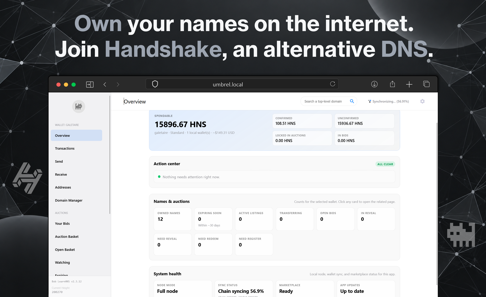
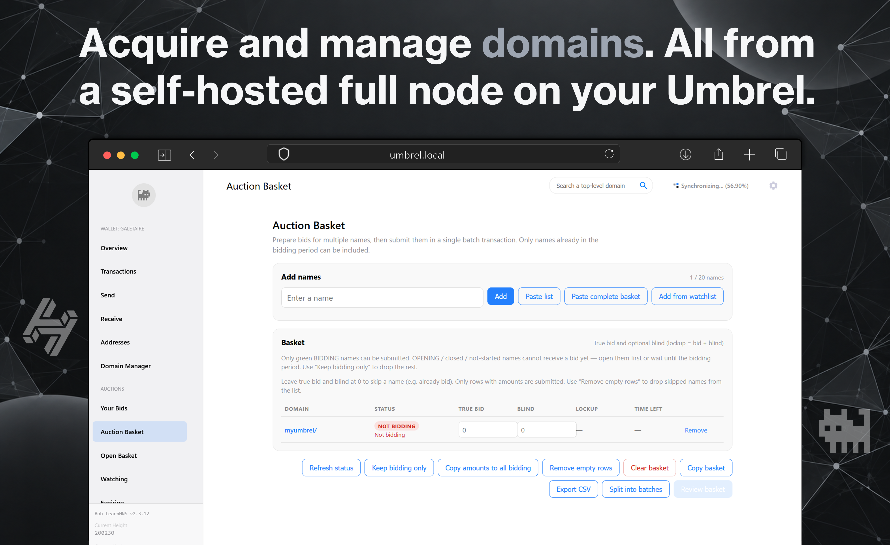
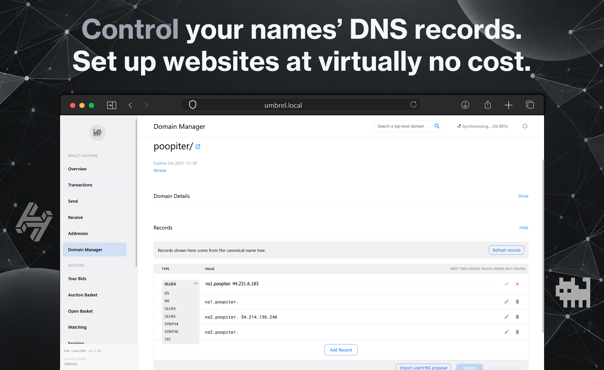

# PR title

Add Bob DNS

# PR description (paste everything below this line)

## Type

New app

## App

App ID: bob-wallet
Upstream project: https://github.com/shadstoneofficial/bob-wallet
Version: 2.3.19

## Summary

Adds Bob DNS, which runs [Bob LearnHNS](https://github.com/shadstoneofficial/bob-wallet) (GPL-3.0, a maintained fork of [Bob Wallet](https://github.com/kyokan/bob-wallet)) on Umbrel: a Handshake (HNS) wallet with a built-in Handshake full node (hsd). Users can hold HNS, bid on name auctions, and manage their Handshake domains and DNS records from the browser.

Bob is an Electron desktop app, and upstream publishes no Docker image and no ARM Linux build. The package uses a wrapper image, `ghcr.io/galetaire/bob-learnhns:2.3.19-web.2` (amd64 and arm64, public), built by GitHub Actions on native runners from [galetaire/bob-dns](https://github.com/galetaire/bob-dns). It builds Bob from its release tag and runs it as a web app without Electron:

- Bob's main process (wallet, hsd node, services) runs under plain Node with a small stand-in for the `electron` module. Bob's own React UI, already a web bundle, is served to the browser and reaches the main process over a WebSocket that carries the same IPC messages Electron would.
- File exports become browser downloads, and imports use the browser's file picker.
- The only change to Bob's source at build time is disabling its Sentry SDK, which needs Electron. The image ships Bob's GPL-3.0 license at `/opt/bob/LICENSE` and a source notice at `/opt/bob/NOTICE`.

Packaging for Umbrel:

- Umbrel login stays on (default `app_proxy` settings). No whitelisted paths.
- The server only accepts connections routed by Umbrel: from the network gateway (umbrelOS's app gateway, which Tor remote access also uses), from this app's `bob-wallet_app_proxy_1` on older umbrelOS, and from loopback. Other containers on `umbrel_main_network` get a 403, so they can't reach the wallet and skip the Umbrel login. The WebSocket also requires a per-start session token embedded in the page.
- The container starts as root only to give `/data` to 1000:1000, then drops privileges with `setpriv` before starting Bob.
- All data lives in `${APP_DATA_DIR}/data/config`, mounted at `/data`. `storage.dataRoot: data` is set.
- `backupIgnore` excludes the re-downloadable Handshake chain (`blocks`, `chain`, `tree`, `spvchain`). The wallet database and Bob's settings are still backed up. Bob's folder is named `Bob LearnHNS`, so the paths use `Bob*LearnHNS`, since spaces aren't allowed.
- `stop_grace_period: 1m` gives hsd time to flush its databases on stop.

## Verification

Umbrel testing performed: installed through a community app store with the same app ID and the same image on a Raspberry Pi 4 running umbrelOS 2.0, then:

- Opened the app from the Umbrel home screen. A fresh install shows Bob's onboarding (create a wallet, import one, or connect a Ledger).
- Imported an existing wallet from its seed phrase.
- Synced in SPV mode and in full-node mode, and switched between them. The full chain resumes from its height after switching back.
- Sent and received HNS, sent and received domains, and updated DNS records.
- Updated the app several times. The wallet, settings and chain data were still there each time.
- With the Umbrel-routing restriction in place, the app works through umbrelOS 2.0's app gateway.

Environment tested:
- [x] Umbrel device (Raspberry Pi 4, umbrelOS 2.0)
- [ ] Local umbrelOS test environment
- [ ] Not runtime tested

Architecture tested:
- [ ] amd64
- [x] arm64

amd64 was tested in Docker on an x86_64 PC, not through Umbrel: fresh install, sync, upgrade from older versions' data, SPV and full-node switching, and the connection restriction on a shared Docker network (gateway and `app_proxy` allowed, other containers refused).

Known lint warnings or caveats: `npm run lint:apps -- bob-wallet --check-images` reports no issues. This exact package wasn't installed through the official store source on a device. It differs from the tested community package only in manifest metadata (`storage`, `backupIgnore`, `version`, no `icon`/`gallery`) and in pinning the same image by digest.

## Notes

- No default credentials. Bob has its own wallet password, set during onboarding.
- No permissions, dependencies, host access, privileged mode or published ports.
- The node starts in SPV mode. A full-node sync takes several days and about 150 GB of disk.
- Ledger hardware wallets are not supported (no USB access).

Logo:

Screenshots:

